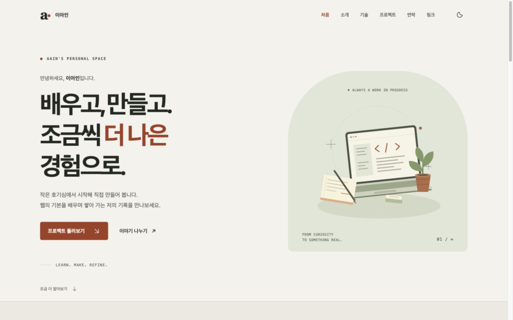
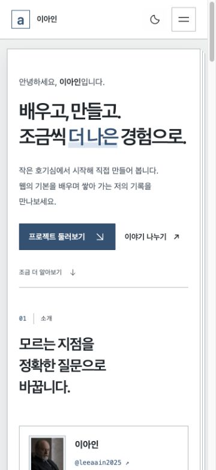
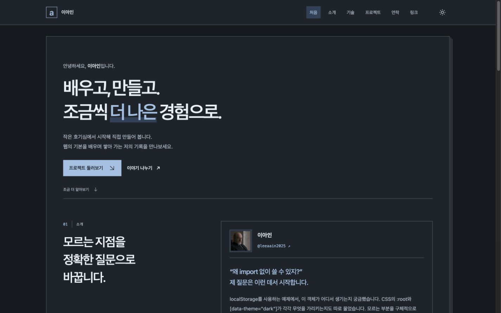

# b1-1 — 이아인의 포트폴리오

순수 HTML, CSS, JavaScript로 만든 반응형 자기소개 포트폴리오입니다. GitHub 공개 저장소를 프로젝트 카드로 표시하고, 메뉴·테마·문의 폼에서 **이벤트 → 상태 변경 → DOM 업데이트** 흐름을 구현했습니다.

| 항목 | 주소 / 상태 |
| --- | --- |
| GitHub 저장소 | [leeaain2025/codyssey-b1-1](https://github.com/leeaain2025/codyssey-b1-1) |
| GitHub Pages | [포트폴리오 보기](https://leeaain2025.github.io/codyssey-b1-1/) — 배포 완료 |
| 요구사항 대응표 | [기능·규칙·검증 절차](docs/requirements.md) |
| 검증 기록 | [실제 확인 결과와 추가 확인 항목](docs/verification.md) |
| 프로젝트 소개 | [선정 기준과 소개 문구의 근거](docs/projects.md) |
| 학습 자료 | [웹 기초 학습 교재](study-guide/README.md) |

## 실행 방법

빌드 과정과 런타임 패키지 설치가 없는 정적 웹사이트입니다.

1. VS Code에서 이 프로젝트 폴더를 엽니다.
2. VS Code 확장에서 **Live Server**를 설치합니다.
3. `index.html`을 오른쪽 클릭하고 **Open with Live Server**를 선택합니다.
4. 열린 `http://127.0.0.1:5500` 형태의 주소에서 확인합니다. 포트는 Live Server 설정에 따라 달라질 수 있습니다.
5. 최신 Chrome에서 개발자 도구의 기기 모드를 켜고 모바일·태블릿·데스크톱 너비를 확인합니다.

파일을 더블클릭한 `file:` 주소보다 HTTP 로컬 서버를 사용하세요. 외부 SVG 아이콘과 브라우저 저장소를 웹사이트와 같은 실행 조건에서 확인할 수 있습니다. GitHub 프로젝트 목록과 GitHub 프로필 이미지를 처음 가져올 때는 인터넷 연결이 필요합니다.

Python이 설치된 환경에서는 프로젝트 폴더에서 다음 명령으로도 실행할 수 있습니다.

```bash
python3 -m http.server 5500
```

이 경우 브라우저에서 `http://localhost:5500`을 엽니다. `localhost`와 `127.0.0.1`, 서로 다른 포트는 별도의 출처이므로 테마 저장값도 각각 관리됩니다.

## GitHub Pages 배포 방식

저장소의 **Settings → Pages → Build and deployment**에서 **Deploy from a branch**를 선택하고, 브랜치를 `main`, 폴더를 `/(root)`로 지정합니다. 루트의 `.nojekyll`은 Jekyll 처리를 거치지 않고 정적 파일을 제공하도록 하는 표시입니다. `main`에 반영한 뒤 Pages 배포가 끝나면 상단의 공개 주소에서 확인합니다.

## 화면 구성과 주요 기능

| 영역 | 내용과 동작 |
| --- | --- |
| Hero | 인사말, 작업 공간 일러스트, 프로젝트·연락 영역으로 이동하는 CTA |
| About | 자기소개, GitHub 프로필 이미지와 계정 링크. 이미지 오류 시 로컬 이니셜 이미지로 대체 |
| Skills | HTML, CSS, JavaScript, Git & GitHub 기술 목록 |
| Projects | 실제 작업이 있는 GitHub 프로젝트의 한 문장 소개, API 카드, 로딩·성공·에러·빈 상태, 재시도, 언어 필터, 정렬 |
| Contact | 이름·이메일·메시지 검증, 항목별 오류, 글자 수, 검증 완료 안내 |
| Footer | 현재 연도의 저작권 표시와 GitHub 소셜 링크 |

- 모바일 햄버거 메뉴는 클릭으로 열고 닫으며, 링크 선택·바깥 클릭·Escape 키·화면 너비 변경으로 닫힙니다.
- 섹션 앵커와 맨 위 버튼으로 부드럽게 이동합니다. 현재 위치에 해당하는 메뉴를 강조합니다.
- 다크 모드를 선택하면 `localStorage`에 저장하고 새로고침 시 복원합니다. 저장값이 없으면 운영체제 테마를 따릅니다.
- 스크롤 시 헤더 배경과 맨 위 버튼을 변경하고, Intersection Observer로 콘텐츠를 드러냅니다.
- 키보드 포커스 표시, 본문 바로가기, 폼 label, 상태 알림, 모션 줄이기 설정을 지원합니다.

## 파일 구조

```text
.
├── index.html                 # 시맨틱 문서와 화면의 기본 구조
├── css/
│   └── style.css              # 테마 변수, 레이아웃, 반응형, 모션
├── js/
│   ├── config.js             # 계정·이름·프로젝트 소개·저장 키·스크롤 기준 설정
│   ├── main.js               # 테마, 메뉴, 스크롤, 화면 등장 효과
│   ├── projects.js           # GitHub 요청, 카드, 필터, 정렬, 상태 화면
│   └── contact.js            # 문의 폼 상태, 검증, 화면 갱신
├── images/
│   ├── workspace.svg         # Hero 작업 공간 일러스트
│   ├── profile.svg           # 프로필 이미지 대체용 이니셜
│   ├── icons.svg             # 로컬 SVG 아이콘 모음
│   └── favicon.svg           # 브라우저 탭 아이콘
├── docs/
│   ├── requirements.md       # 과제 요구사항과 구현 위치·검증 방법
│   ├── verification.md       # 실제 브라우저 검증과 미확인 범위
│   ├── projects.md           # 프로젝트 선정 기준과 소개 문구의 근거
│   └── screenshots/          # 데스크톱·모바일·다크 모드 캡처
├── study-guide/
│   └── README.md             # 여섯 가지 학습 목표를 설명하는 교재
├── tests/                    # Node 기본 테스트 러너로 실행하는 검증
├── .nojekyll                 # 정적 GitHub Pages 배포 표시
└── README.md
```

모든 스타일은 외부 CSS에, 이벤트는 외부 JavaScript에 작성했습니다. JavaScript는 `config → main → projects → contact` 순서로 `defer` 연결하여 HTML 파싱 이후 실행합니다. 기능별 파일은 즉시 실행 함수로 감싸 내부 변수 이름이 서로 충돌하지 않도록 했습니다.

## 사용 기술과 선택 이유

| 기술 | 적용과 이유 |
| --- | --- |
| 시맨틱 HTML | `header`, `nav`, `main`, `section`, `article`, `footer`로 문서의 역할을 구분합니다. 각 주제에는 제목을, 독립적으로 읽을 수 있는 프로젝트 카드에는 `article`을 사용합니다. |
| CSS custom properties | `:root`에서 색·폰트·간격을 관리하고 `[data-theme="dark"]`에서 색상 변수를 바꿉니다. 같은 구성 요소가 테마에 따라 일관되게 변경됩니다. |
| Flexbox | 로고·메뉴·버튼처럼 한 줄 방향의 정렬에 사용합니다. 헤더의 로고는 왼쪽, 메뉴와 조작 버튼은 오른쪽에 배치합니다. |
| Grid | 프로젝트 카드처럼 행과 열을 함께 구성하는 배치에 사용합니다. `repeat(auto-fit, minmax(min(100%, 19rem), 1fr))`로 공간에 맞는 열 수를 만듭니다. |
| 모바일 퍼스트 CSS | 작은 화면을 기본으로 작성하고 `min-width: 768px`, `min-width: 1024px`에서 배치와 여백을 확장합니다. |
| 브라우저 기본 JavaScript | DOM, 이벤트, `fetch`, `localStorage`, `IntersectionObserver`를 직접 사용하여 상태와 화면의 연결을 학습합니다. |
| 로컬 SVG·시스템 폰트 | 별도 UI 라이브러리나 외부 아이콘 패키지 없이 아이콘과 일러스트를 표시합니다. |

React, Vue, jQuery, Bootstrap, Tailwind를 사용하지 않았습니다. 인라인 `style`과 `onclick`을 사용하지 않고 클래스·데이터 속성과 `addEventListener`로 동작을 연결합니다. 변수 선언은 `const`와 `let`만 사용합니다.

## 상태에서 화면이 바뀌는 흐름

`querySelector` 또는 `querySelectorAll`로 DOM을 선택한 뒤, `addEventListener`로 사용자의 행동을 연결합니다. 이벤트가 발생하면 상태를 바꾸고 그 상태를 읽는 렌더 함수를 호출합니다.

### 1. 다크 모드

```text
테마 버튼 click
  → state.theme을 light ↔ dark로 변경
  → renderTheme()
  → <html data-theme>, 버튼 접근성 이름, 브라우저 테마 색 변경
  → localStorage에 선택 저장
```

`main.js`의 `state.theme`이 현재 선택입니다. `renderTheme()`은 이 값을 읽어 DOM에 반영하며, CSS가 `data-theme`에 따라 색상 변수를 적용합니다. 저장소 읽기·쓰기를 `try/catch`로 감싸 저장이 차단되어도 현재 화면의 전환은 동작하도록 했습니다. 유효한 저장값은 사용자의 명시적 선택으로 취급하여 시스템 설정 변경보다 우선합니다.

### 2. GitHub 목록과 언어 필터

```text
페이지 시작 / 재시도 click
  → state.isLoading = true
  → 로딩 패널 표시
  → await fetch(...), await response.json()
  → 성공: 소개 목록과 대조 → 선정한 state.repositories 저장 → renderRepositories()
  → 실패: 에러 패널과 재시도 버튼 표시

언어 필터 click / 정렬 change
  → state.language / state.sort 변경
  → filter로 표시할 저장소 계산 → sort로 순서 계산
  → map(renderCard).join("") → 카드 DOM 갱신
```

서버에서 가져와 선정한 프로젝트 목록과 현재 언어 필터를 별도로 저장합니다. `filter`가 만든 새 배열을 정렬하기 때문에 선정 목록의 원래 순서가 변하지 않습니다. `map`은 저장소 객체 각각을 카드 HTML로 변환합니다. `renderCard`의 구조분해 할당으로 이름·설명·주소 등을 꺼내고, 템플릿 리터럴로 마크업을 구성합니다.

### 3. 문의 폼

```text
input / blur
  → state.values와 state.touched 변경
  → validateField()로 오류 계산
  → renderField()로 오류·aria-invalid·글자 수 갱신

submit
  → preventDefault()
  → 모든 필드 검증 → state.errors / state.submitted 변경
  → renderFeedback()
  → 오류가 있으면 첫 오류 입력으로 포커스 이동
  → 오류가 없으면 검증 완료 안내
```

입력값(`values`), 오류(`errors`), 확인한 필드(`touched`), 제출 시도(`submitted`)를 분리했습니다. 아직 조작하지 않은 항목에 처음부터 오류를 보여주지 않습니다. 오류를 한 번 확인한 항목은 입력하는 동안 다시 검증합니다. 성공 후 수정하면 이전 성공 안내와 메일 링크를 숨겨 현재 입력과 표시가 어긋나지 않도록 합니다.

추가로 메뉴의 `menuOpen → renderMenu()`와 스크롤의 위치 계산 → 헤더·버튼 갱신도 상태와 DOM의 연결을 보여줍니다.

## 기준값과 설정

| 항목 | 실제 값 | 적용 위치 / 의미 |
| --- | --- | --- |
| 헤더 배경 변경 | `scrollY >= 60`px | `navigationScrollThreshold`; 59px에서는 기본, 60px부터 변경 |
| 맨 위 버튼 표시 | `scrollY >= 300`px | `backToTopThreshold`; 299px에서는 숨김, 300px부터 표시 |
| 등장 효과 | `threshold: 0.2` | `revealThreshold`; 대상의 교차 비율이 20% 이상이면 표시 클래스 추가 |
| 태블릿 확장 | `min-width: 768px` | 가로 메뉴·다단 배치 시작 |
| 데스크톱 확장 | `min-width: 1024px` | 여백·글자 크기·배치 확장 |
| GitHub 전체 요청 제한 시간 | 15초 | `AbortController`로 요청 중단 후 재시도 안내 |
| 이름 | 필수, 최대 80자 | 앞뒤 공백을 제거했을 때 빈 값인지 검사 |
| 이메일 | 필수, 최대 254자 | 브라우저 이메일 형식과 기본 이메일 패턴 검사 |
| 메시지 | 필수, 10~2,000자 | 최소 길이는 앞뒤 공백 제외, 최대 길이·표시 글자 수는 전체 입력 기준 |

등장 효과는 한 번 보인 요소를 `unobserve`하여 반복하지 않습니다. `prefers-reduced-motion: reduce`이거나 Intersection Observer를 지원하지 않는 환경에서는 콘텐츠를 숨기지 않습니다. 모션 줄이기가 켜진 환경에서는 부드러운 이동도 즉시 이동으로 바뀝니다.

`js/config.js`에서 이름, GitHub 계정, 프로젝트 소개, 공개 연락 이메일과 기준값을 관리합니다. 테마 저장 키는 `leeaain2025-portfolio-theme`입니다. `contactEmail`은 현재 비어 있습니다.

`projectDescriptions`는 `"소유자/저장소": "한 문장 소개"` 형식의 선정 목록입니다. 실제 파일과 커밋을 확인한 7개 프로젝트를 등록했고, 초기 README만 있는 `codyssey-b2-1`은 제외했습니다. 새 프로젝트를 소개하려면 내용을 확인한 뒤 이 목록에 추가합니다. 파일 크기나 커밋 수만으로 자동 판정하지 않습니다. [선정 기준과 근거](docs/projects.md)를 참고하세요.

## GitHub API와 네 가지 화면 상태

요청 주소는 다음과 같습니다.

```text
https://api.github.com/users/leeaain2025/repos?per_page=100&sort=updated&direction=desc&type=owner
```

인증 없이 사용자가 소유한 공개 저장소를 조회하며, 다음 페이지가 있으면 응답의 `Link` 헤더를 따라 추가 요청합니다. 페이지당 최대 100개를 요청하고 `id`로 중복을 제거합니다. 공개 저장소 조회와 매개변수는 [GitHub 공식 문서](https://docs.github.com/en/rest/repos/repos#list-repositories-for-a-user)를 따릅니다.

API에서 실제로 반환된 저장소 중 `projectDescriptions`에 유효한 소개가 등록된 항목만 카드로 표시합니다. 소개는 직접 작성한 문장을 사용하고 이름·언어·별·포크·업데이트 날짜·링크는 API 값을 사용합니다. 필터와 개수도 선정 목록을 기준으로 계산합니다. 목록에 적어 두어도 API에 없는 저장소는 표시하지 않습니다. `projectDescriptions` 설정을 생략하면 기존처럼 API 전체 목록과 GitHub 설명을 사용합니다.

| 상태 | 사용자에게 보이는 내용 | 처리 |
| --- | --- | --- |
| 로딩 | 스피너와 “프로젝트를 불러오는 중…” | 필터·정렬 비활성화, `aria-busy` 설정 |
| 성공 | 저장소 이름·설명·언어·별·포크·업데이트 날짜·링크 카드 | 필터와 정렬 사용 가능 |
| 실패 | “프로젝트를 불러올 수 없습니다”와 원인 안내·재시도 버튼 | HTTP 오류, 네트워크 오류, 잘못된 JSON, 응답 시간 초과 처리 |
| 빈 상태 | “표시할 프로젝트가 없습니다” | 빈 배열·선정 결과 없음 또는 선택한 언어에 결과가 없는 경우 구분 |

`fetch`는 HTTP 403/404 등의 상태만으로 예외를 던지지 않으므로 `response.ok`를 직접 검사합니다. 403·429는 요청 제한 안내, 404는 계정 확인 안내로 처리합니다. 15초 제한은 전체 목록을 가져오는 요청 묶음에 적용됩니다.

인증 없는 요청의 기본 한도는 IP 주소 기준 시간당 60회이며, 같은 네트워크의 다른 요청과 한도를 공유할 수 있습니다. 추가 제한도 있으므로 요청 실패 시 잠시 기다린 뒤 재시도하세요. [GitHub 요청 제한 안내](https://docs.github.com/en/rest/using-the-rest-api/rate-limits-for-the-rest-api)

클라이언트 코드에는 인증 토큰을 넣지 않습니다. API 문자열과 직접 작성한 소개 모두 HTML 특수문자를 이스케이프한 후 카드에 넣고, 저장소 링크는 `https://github.com` 주소만 허용합니다. API에서 언어가 비어 있으면 “기타”를 표시합니다. 선정 설정을 생략한 경우에는 빈 설명에 대체 문구를 표시합니다.

## 문의 폼의 범위

이 폼은 과제의 **입력 검증과 성공 안내**를 구현합니다. 서버나 Formspree·EmailJS에 연결하지 않았으므로 제출해도 이메일이 자동 발송되지 않습니다. 현재는 검증 성공 시 “입력 확인이 완료되었습니다. 아직 메시지는 전송되지 않았습니다.”를 표시하고 입력값을 보존합니다.

`config.js`의 `contactEmail`에 공개할 이메일을 설정하면 검증 성공 후 **메일 앱에서 보내기** 링크가 나타납니다. 작성한 내용을 URL 인코딩해 메일 앱 초안으로 전달하며, 실제 전송은 사용자가 메일 앱에서 마무리합니다. 이 방식도 사이트의 자동 발송 기능은 아닙니다.

## 검증 절차

아래는 평가자가 재현할 수 있는 확인 순서입니다. 기대 결과와 실제 수행 결과를 구분하며, 상세 항목은 [요구사항 대응표](docs/requirements.md)에 정리했습니다.

1. **화면·구조:** 375px, 768px, 1024px, 1440px 너비에서 전체 영역과 가로 넘침을 확인합니다. 메뉴·CTA·GitHub 링크·이미지·폼 label을 확인합니다.
2. **메뉴·스크롤:** 모바일 메뉴를 열고 닫고, Escape와 섹션 선택으로 닫히는지 확인합니다. 스크롤 59/60px 및 299/300px 경계에서 헤더와 맨 위 버튼을 확인합니다.
3. **테마:** 버튼을 클릭하고 새로고침하여 유지 여부를 확인합니다. 개발자 도구 Application → Local Storage에서 저장 키를 삭제한 뒤 시스템 테마를 바꿔 초기 테마도 확인합니다.
4. **API:** 정상 네트워크에서 실제 저장소 카드가 생성되는지 확인합니다. 개발자 도구 Network에서 Slow 3G로 로딩을 확인하고, Offline으로 새로고침하여 실패 안내를 확인한 뒤 Online으로 바꾸고 재시도합니다.
5. **폼:** 빈 값·공백·잘못된 이메일·10자 미만 메시지를 제출합니다. 필드 근처 오류와 첫 오류 포커스를 확인하고, 유효한 값으로 고치면 새로고침 없이 검증 완료 안내가 나오는지 확인합니다.
6. **접근성·모션:** Tab·Shift+Tab·Enter·Escape로 이동합니다. 본문 바로가기, 버튼 이름, 포커스 표시를 확인합니다. 모션 줄이기 설정에서도 모든 콘텐츠가 보이는지 확인합니다.
7. **배포:** 공개 후 GitHub Pages 주소에서 위 흐름을 다시 확인합니다. 하위 경로 배포에서도 CSS·JS·SVG가 로드되는지 확인합니다.

2026년 10월 19일 최초 구현의 로컬 HTTP 환경에서 다음을 확인했습니다. 아래 8개 표시는 프로젝트 선정 기능을 적용하기 전의 기록입니다.

- 320·375·768·1024·1440px에서 가로 넘침 없음. 프로젝트는 375px에서 1열, 768·1024px에서 2열, 1440px에서 3열로 표시되었습니다.
- 실제 GitHub API에서 공개 저장소 8개를 표시했고, Python 필터에서 3개가 표시되며 정렬이 동작했습니다. 저장소 수는 계정 변경에 따라 달라질 수 있습니다.
- 다크 모드 선택 후 새로고침해도 유지되었습니다.
- 빈 폼의 세 필드 오류와 첫 오류 포커스, 이메일·메시지 오류, 유효한 입력의 검증 완료 및 미전송 안내를 확인했습니다.
- 모바일 메뉴의 Escape·링크 선택 닫기와 667×320 가로 화면에서 메뉴 마지막 항목 접근을 확인했습니다.
- 키보드의 첫 Tab으로 본문 바로가기 링크에 도달하고 Enter로 실행하면 `main-content`에 포커스가 이동했습니다.
- 두 이미지가 로드되었고, 확인한 브라우저 세션의 콘솔 오류·경고는 0건이었습니다.

프로젝트 선정 기능을 포함한 **자동 테스트 46개가 모두 통과**했습니다. `main` 5개, `projects` 22개, `contact` 14개, `structure` 5개로 구성되며 Node의 기본 테스트 러너와 DOM·네트워크 모의 환경을 사용합니다. 추가 4개는 소개 교체·선정 목록의 필터와 개수·API 교집합·빈 결과·유효하지 않은 소개·HTML 이스케이프를 검증합니다. 테스트만 실행할 때 Node.js가 필요하고, 사이트 실행에는 Node.js가 필요하지 않습니다.

```bash
node --test tests/*.test.mjs
```

자동 테스트는 스크롤 경계, 저장소 예외, 등장 효과 임계값, API 오류·빈 목록·재시도·페이지네이션·인코딩, 폼 검증, 소스 구조를 확인합니다. **브라우저에서 API 오류·빈 상태를 강제 재현한 결과와 모션 줄이기 화면은 위 브라우저 결과에 포함되지 않습니다.** 정확한 수행 범위와 추가 절차는 [검증 기록](docs/verification.md)에 구분했습니다.

최초 GitHub Pages 빌드 성공을 확인한 뒤 공개 주소에서도 CSS·JS·이미지 로드, GitHub 저장소 8개 표시, 다크 모드 새로고침 유지, 모바일 메뉴 이동, 유효한 문의 폼 제출 안내를 확인했습니다. 당시 배포 화면의 콘솔 오류·경고는 0건이었습니다.

## 스크린샷

실제 로컬 페이지를 데스크톱 1440×900, 모바일 375×812 뷰포트에서 캡처했습니다. 전체 페이지 캡처는 화면 아래의 섹션까지 확인할 수 있습니다.

| 화면 | 뷰포트 캡처 | 전체 페이지 |
| --- | --- | --- |
| 데스크톱 | [desktop.png](docs/screenshots/desktop.png) | [desktop-full.png](docs/screenshots/desktop-full.png) |
| 모바일 | [mobile.png](docs/screenshots/mobile.png) | [mobile-full.png](docs/screenshots/mobile-full.png) |
| 다크 모드 | [dark.png](docs/screenshots/dark.png) | [dark-full.png](docs/screenshots/dark-full.png) |

### 데스크톱



### 모바일



### 다크 모드



## 선택 기능과 남은 외부 설정

선택 기능으로 언어별 `filter()` 필터와 시스템 테마 감지를 구현했고, 최근 업데이트순·별이 많은 순 정렬을 추가했습니다. Hero 타이핑 효과와 외부 서비스 자동 이메일 전송은 구현하지 않았습니다.

GitHub Pages는 `main` 브랜치의 루트 디렉터리에서 배포합니다. 구현 설명, 요구사항 대응표, 검증 기록과 스크린샷을 저장소에 함께 보관합니다. [실제 배포 화면](docs/screenshots/deployed.png)도 확인할 수 있습니다.
